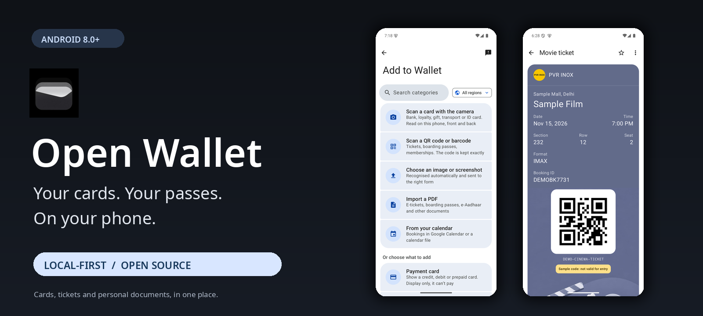
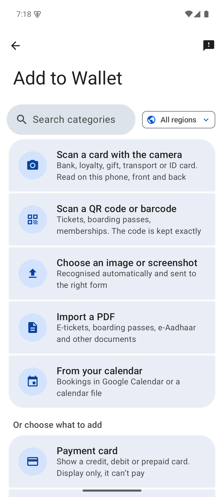
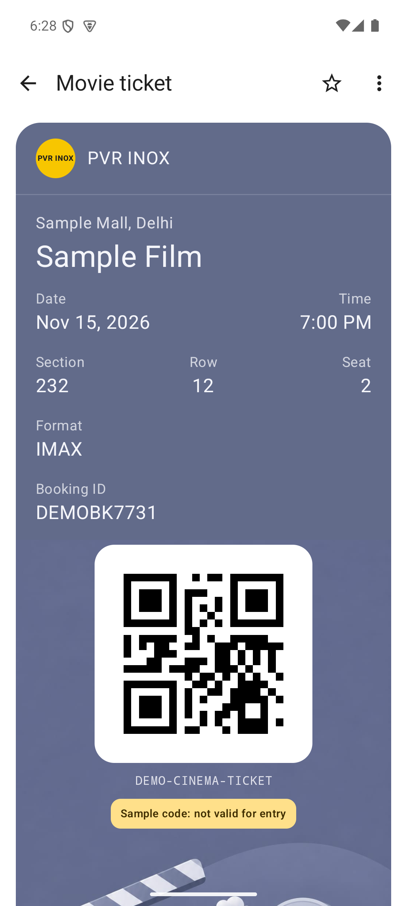

<p align="center"></p>

<p align="center"><strong>A local-first Android wallet for cards, passes and personal documents.</strong></p>
<p align="center">Kotlin · Jetpack Compose · Android 8.0+ · MIT</p>

Keep display copies of payment cards, tickets, loyalty cards and personal documents together. Scan a card, import an image or PDF, or add the details yourself. No app account is required.

## At a glance

- **Scan and import:** camera capture, on-device text and barcode recognition, image and PDF import, then review before saving.
- **Cards and passes:** payment-card display copies, boarding passes, travel and event tickets, loyalty, gift and custom passes.
- **Personal document vault:** encrypted storage with Android Keystore integration and biometric or device-lock access.
- **Local-first:** core wallet features work without an app account. Google Calendar import is optional and requires separate setup.

<table>
<tr>
<td width="33%"></td>
<td width="33%"></td>
<td width="33%"></td>
</tr>
<tr><td align="center">Add your way</td><td align="center">Review recognised details</td><td align="center">Your tickets, together</td></tr>
</table>

App screenshots supplied with the project, captured on an emulator. Card and ticket details are demo data. The sample ticket is not valid for entry.

## Install

Version **2.1.0** is the current version in the Android source.

**Upgrade hold:** source review found that a failed migration from the older 1.x database can still delete the original database. Do not upgrade a 1.x install with this build until migration handling is fixed and tested. This has not been reproduced on a device.

The phone APK is named `OpenWallet-2.1.0.apk` and targets **64-bit ARM** devices. Android 8.0 or newer is required. Install APKs only from a source you trust, and back up your data before updating.

The supplied APK has passed ZIP integrity and APK v2 signature checks. Upload to GitHub Releases is still pending; there is no published APK download here yet. This is not an installation or device test.

SHA-256 of the supplied `OpenWallet-2.1.0.apk`:

```text
0734a08563a81f99008efc3801be6b7ede9a2570a3d39cf4203fe5979c95bb31
```

## Build from source

Requires **JDK 17**, Android SDK platform **36** and build-tools **36.0.0**.

```bash
cd android
./gradlew testDebugUnitTest
./gradlew assembleRelease
```

On Windows, use `gradlew.bat`. Build the Play bundle separately with `./gradlew bundleRelease`.

The existing build uses a private upload key when configured, otherwise a debug key. A locally built APK is not necessarily signed for updating an existing install. Never commit signing keys or signing passwords.

## Notes

Cards are display copies, not contactless payment credentials. Documents are personal copies, and saved tickets do not establish validity with an operator. The project includes historical emulator notes and unit tests; this repository preparation is not a new device test or security audit.

See [capability details](android/docs/CAPABILITIES.md), [Calendar setup](android/docs/GOOGLE_CALENDAR_SETUP.md) and the [privacy policy](android/docs/PRIVACY_POLICY.md).

## Project map

| Path | Purpose |
|---|---|
| `android/` | Android app, Gradle build and device-test scripts |
| `android/app/src/main/` | Kotlin source, resources and catalogue |
| `android/app/src/test/` | Android unit tests |
| `src/`, `main.js`, `preload.js` | Earlier Electron desktop prototype |
| `scripts/`, `test/` | Desktop tooling, catalogue export and tests |
| `docs/` | Technical notes and repository imagery |

The Android app is the product. The desktop prototype is retained as development history, not a desktop release.

## License and attribution

Code is provided under the [MIT License](LICENSE). The supplied license also identifies Material Icons paths under Apache 2.0. Keep applicable third-party notices when redistributing.

Open Wallet is an independent project, not affiliated with Google, banks, card networks, transport operators or governments. Provider names identify the relevant card or pass; they do not imply endorsement.
